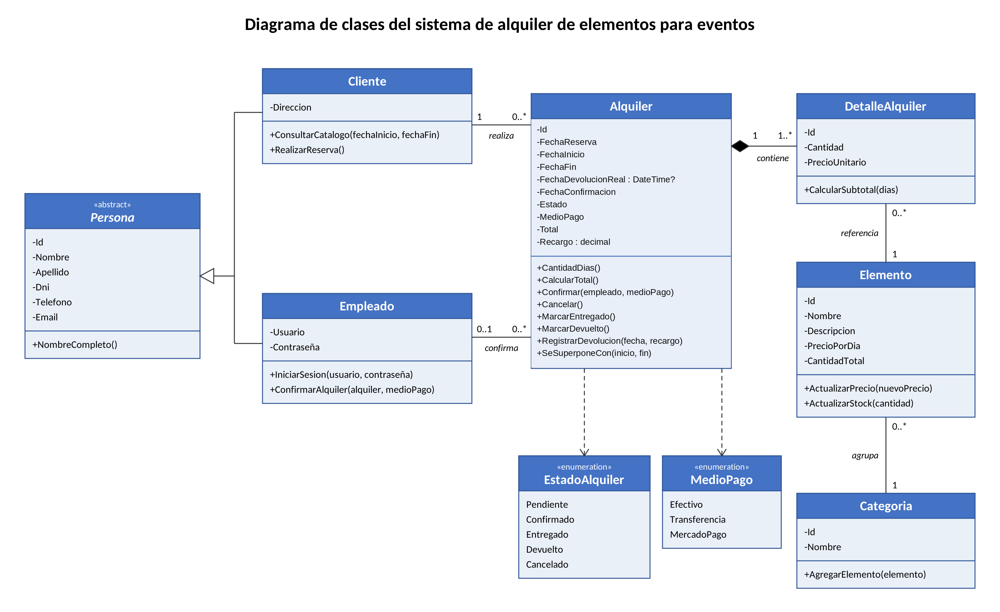

# TP_AlquilerDeEventos_G10

**Sistema de gestión de alquileres de elementos para eventos**

**Integrantes:** Celeste Ball — Jazmín Villa

## Descripción del sistema

Sistema de escritorio para la gestión de un negocio de alquiler de elementos para eventos, como cumpleaños, casamientos o reuniones.

El sistema cuenta con dos tipos de usuario:

- **Cliente:** se identifica, selecciona la fecha de su evento y consulta el catálogo completo, donde cada elemento muestra la cantidad de unidades disponibles para ese día o la indicación "No disponible". A partir de ahí, realiza su reserva eligiendo los elementos y las cantidades que necesita, y se comunica con el negocio por WhatsApp para acordar el pago.
- **Empleado:** gestiona el catálogo (elementos, categorías, precios y stock), confirma las reservas una vez verificado el pago, controla el estado de los alquileres, registra las devoluciones y los posibles recargos, y consulta los reportes.

Antes de registrar una reserva, el sistema verifica que las cantidades solicitadas no superen las unidades disponibles, evitando comprometer más elementos de los que el negocio tiene.

### Entidades principales

| Entidad | Descripción |
|---|---|
| **Persona** | Clase base con los datos comunes de clientes y empleados: nombre, apellido, DNI, teléfono y email. |
| **Cliente** | Persona que alquila elementos para un evento. Además de sus datos personales, registra su dirección. |
| **Empleado** | Persona que trabaja en el negocio. Ingresa al sistema con usuario y contraseña y confirma las reservas. |
| **Categoria** | Agrupa los elementos según su tipo, por ejemplo mesas, sillas o vajilla. |
| **Elemento** | Artículo que el negocio ofrece en alquiler. Tiene un precio por día y una cantidad total de unidades. |
| **Alquiler** | Reserva que realiza un cliente para un rango de fechas. Registra la fecha de la reserva, la fecha límite de devolución (FechaFin), la fecha real de devolución, su estado, el medio de pago, el empleado que la confirmó, el importe del alquiler y un posible recargo manual por demora. |
| **DetalleAlquiler** | Cada elemento incluido en un alquiler, con la cantidad de unidades y el precio al momento de alquilar. |

**Estados de un alquiler:** Pendiente → Confirmado → Entregado → Devuelto. En cualquier momento antes de la entrega puede pasar a Cancelado.

---

## Objetivos

- Permitir que los clientes consulten la disponibilidad de los elementos para la fecha de su evento y realicen sus reservas.
- Evitar que se reserven más unidades de las que el negocio tiene disponibles en una fecha determinada.
- Dar al negocio el control sobre la confirmación de las reservas, una vez acordado y verificado el pago.
- Llevar un registro ordenado de clientes, empleados, elementos y alquileres.
- Registrar la fecha real de devolución de los elementos y los posibles recargos por demora.
- Obtener información útil para la gestión del negocio mediante reportes.

---

## Funcionalidades

### Cliente

| Funcionalidad | Descripción |
|---|---|
| Identificación y registro | Ingresa su DNI; si no está registrado, carga sus datos personales y de contacto. |
| Consulta del catálogo por fecha | Selecciona la fecha de su evento y visualiza todos los elementos con las unidades disponibles o la indicación "No disponible". |
| Alta de reserva | Elige los elementos y las cantidades. La reserva queda Pendiente y las unidades quedan ocupadas, salvo que se cancele. |
| Contacto por WhatsApp | Al registrar la reserva, se abre WhatsApp con un mensaje al negocio con el detalle del alquiler, para coordinar el pago. |

### Empleado

| Funcionalidad | Descripción |
|---|---|
| ABM de Elementos | Alta, baja, modificación y consulta de los elementos del catálogo, con su precio por día y cantidad total. |
| ABM de Categorías | Alta, baja, modificación y consulta de las categorías de elementos. |
| ABM de Clientes | Consulta, modificación y baja de los clientes registrados. |
| Gestión de Alquileres | Confirmar las reservas pendientes una vez verificado el pago, registrar el medio de pago, cancelar reservas y actualizar el estado. |
| Registro de devoluciones y recargos | Al recibir los elementos, registrar la fecha real de devolución. Si se devuelven después de la fecha de fin acordada, el empleado ingresa manualmente el importe del recargo correspondiente. |

### Reportes

| N° | Reporte | Descripción |
|---|---|---|
| 1 | Disponibilidad por fecha | Unidades disponibles de cada elemento para una fecha determinada. |
| 2 | Reservas pendientes de confirmación | Reservas en estado Pendiente, con la fecha en que fueron realizadas. |
| 3 | Alquileres entre fechas | Listado de alquileres dentro de un período. |
| 4 | Elementos más alquilados | Ranking de elementos según la cantidad de unidades alquiladas. |
| 5 | Alquileres pendientes de devolución | Alquileres en estado Entregado cuya fecha de fin ya pasó y todavía no registran una devolución real. |

---

## Control de devoluciones y recargos

El sistema permitirá registrar las devoluciones de los elementos alquilados y controlar si se realizaron dentro del plazo acordado.

Para esto, la entidad **Alquiler** contará con los siguientes atributos:

- **FechaFin:** representa la fecha límite acordada para la devolución.
- **FechaDevolucionReal:** registra cuándo el cliente devolvió efectivamente los elementos. Puede permanecer vacía mientras no se haya realizado la devolución.
- **Recargo:** importe adicional por una devolución fuera de término.

El recargo será establecido **manualmente por el empleado**. No se calculará automáticamente mediante porcentajes o importes diarios.

Si la devolución se realiza dentro del plazo acordado, el recargo será de $0.

Cuando se registra una devolución, el sistema guardará la fecha real, el recargo correspondiente y actualizará el estado del alquiler a **Devuelto**.

Para realizar esta operación, la clase `Alquiler` tendrá el método `RegistrarDevolucion(fecha, recargo)`.

El importe original del alquiler y el recargo se almacenarán por separado, permitiendo identificar ambos conceptos.

---

## Diagrama de clases

---

## Arquitectura e integración de capas

La solución se divide en dos proyectos:

| Proyecto | Contenido |
|---|---|
| **AlquilerDeEventos.Datos** (Biblioteca de clases) | Contiene los modelos, el contexto de Entity Framework Core (`AlquileresContext`) y los repositorios encargados de guardar y consultar los datos. También aplica reglas del negocio, como la verificación de disponibilidad. |
| **AlquilerDeEventos.UI** (Aplicación WinForms) | Contiene los formularios que permiten al usuario interactuar con el sistema. Muestra la información, recibe los datos ingresados y realiza validaciones. Se comunica con los repositorios para acceder a los datos. |

### Ejemplo: cómo se guarda una reserva

1. **Interfaz (WinForms):** el cliente selecciona las fechas, elige los elementos y sus cantidades y presiona "Reservar". El formulario valida que los campos obligatorios estén completos, que las cantidades sean mayores a cero y que la fecha de fin no sea anterior a la fecha de inicio.
2. **Interfaz → Biblioteca de clases:** el formulario crea un objeto `Alquiler` con sus `DetalleAlquiler` y lo envía al repositorio mediante `AlquilerRepository.Agregar(alquiler)`.
3. **Repositorio:** verifica la disponibilidad de los elementos para las fechas seleccionadas. Si existe disponibilidad, calcula el total y asigna el estado Pendiente.
4. **Contexto (Entity Framework Core):** el repositorio agrega el alquiler al `AlquileresContext` y ejecuta `SaveChanges()`.
5. **Base de datos:** Entity Framework Core guarda los datos del alquiler y sus detalles en las tablas correspondientes.
6. **Respuesta:** el formulario informa que la reserva se registró correctamente y abre WhatsApp con el detalle para coordinar el pago.

Cuando el empleado confirma una reserva, el procedimiento es similar: el formulario se comunica con el repositorio, que actualiza el estado del alquiler y guarda los cambios en la base de datos.

### Ejemplo: cómo se registra una devolución

1. **Interfaz (WinForms):** el empleado selecciona un alquiler entregado e ingresa la fecha real de devolución.
2. **Registro del recargo:** si la devolución se realizó fuera del plazo acordado, el empleado ingresa manualmente el importe adicional.
3. **Validación:** el sistema comprueba que los datos ingresados sean válidos y que el recargo no sea negativo.
4. **Biblioteca de clases:** se utiliza el método `RegistrarDevolucion(fecha, recargo)` para registrar ambos datos y cambiar el estado del alquiler a Devuelto.
5. **Repositorio y contexto:** se actualiza el alquiler mediante Entity Framework Core y se ejecuta `SaveChanges()`.
6. **Base de datos:** queda almacenada la fecha real de devolución y el recargo correspondiente, permitiendo consultar posteriormente esta información.

---

## Tecnologías

- C#
- .NET
- Windows Forms
- Entity Framework Core
- SQL Server
